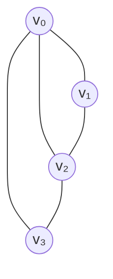
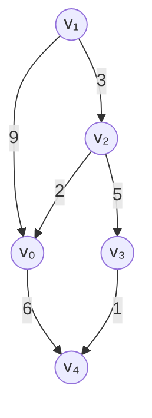

# 图 Graph

图由顶点（vertex）和边（edge）组成，通常表示为 G = (V, E)

- G表示一个图，V时顶点，E时边集
- 顶点集V有穷且非空
- 任意两个顶点之间都可以用边来表示他们的数据关系，边集E可以是空的

# 图的应用举例

图结构的应用极其广泛

- 社交网络
- 社交导航
- 游戏开发

# 有向图（Directed Graph）

- 有向图的边是有明确方向的
- 有向无环图（Directed Acyclic Graph，简称DAG）

如果一个有向图，从任意一个顶点出发无法经过若干条边回到该顶点，那么它就是一个邮箱无环图

# 出度入度

出度入度只适用于有向图

出度（Out-degree）

一个顶点的出度为x，是指有x条边以该顶点为起点

入度（In-degree）

一个顶点的入度为x，是指有x条边以该顶点为终点

# 无向图（Undirected Graph）

# 混合图

# 图的实现方案

图有2种常见的实现方案

- 邻接矩阵（Adjucency Matrix）
- 邻接表（Adjucency List）

# 邻接矩阵(Adjucency Matrix)

邻接矩阵存储方式

- 一维数组存放顶点信息
- 二维数组存放边的信息

**顶点数组**

| 索引 | 0 | 1 | 2 | 3 |
| :---: | :---: | :---: | :---: | :---: |
| 顶点 | v₀ | v₁ | v₂ | v₃ |

**边数组（邻接矩阵）**

| 顶点 | v₀ | v₁ | v₂ | v₃ |
| :---: | :---: | :---: | :---: | :---: |
| v₀ | 0 | 1 | 1 | 1 |
| v₁ | 1 | 0 | 1 | 0 |
| v₂ | 1 | 1 | 0 | 1 |
| v₃ | 1 | 0 | 1 | 0 |

本例是无向无权图，顶点数组为 `[v₀, v₁, v₂, v₃]`，矩阵的行、列按此顺序排列。

- `matrix[i][j] = 1` 表示顶点 `vᵢ` 与 `vⱼ` 之间有边，`0` 表示没有边。
- 例如 `matrix[0][2] = 1`，表示 `v₀` 与 `v₂` 相连。
- 无向图的邻接矩阵关于主对角线对称；本例没有自环，所以主对角线均为 `0`。

邻接矩阵比较适合稠密图，不然的话比较浪费存储空间

# 邻接矩阵 - 有权图

**顶点数组**

| 索引 | 0 | 1 | 2 | 3 | 4 |
| :---: | :---: | :---: | :---: | :---: | :---: |
| 顶点 | v₀ | v₁ | v₂ | v₃ | v₄ |

**边数组（邻接矩阵）**

| 起点 / 终点 | v₀ | v₁ | v₂ | v₃ | v₄ |
| :---: | :---: | :---: | :---: | :---: | :---: |
| v₀ | ∞ | ∞ | ∞ | ∞ | 6 |
| v₁ | 9 | ∞ | 3 | ∞ | ∞ |
| v₂ | 2 | ∞ | ∞ | 5 | ∞ |
| v₃ | ∞ | ∞ | ∞ | ∞ | 1 |
| v₄ | ∞ | ∞ | ∞ | ∞ | ∞ |

本例是有向有权图，顶点数组为 `[v₀, v₁, v₂, v₃, v₄]`。

- `matrix[i][j]` 存储从 `vᵢ` 指向 `vⱼ` 的边的权重，行表示起点，列表示终点。
- `∞` 表示没有直接边，不代表两个顶点之间没有其他路径。
- 例如 `matrix[1][0] = 9`，表示 `v₁ → v₀` 的权重为 `9`；`matrix[0][1] = ∞`，表示没有 `v₀ → v₁` 的直接边。
- 有向图的邻接矩阵不一定对称；本例没有自环，主对角线也用 `∞` 表示。

# 邻接表

# 逆邻接表
